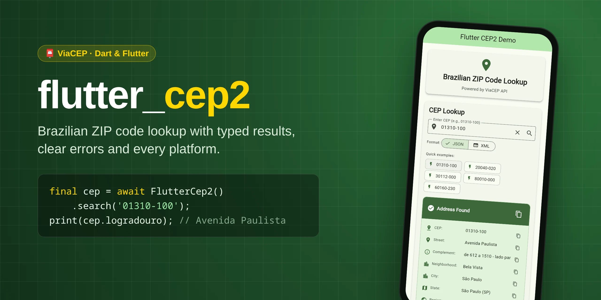
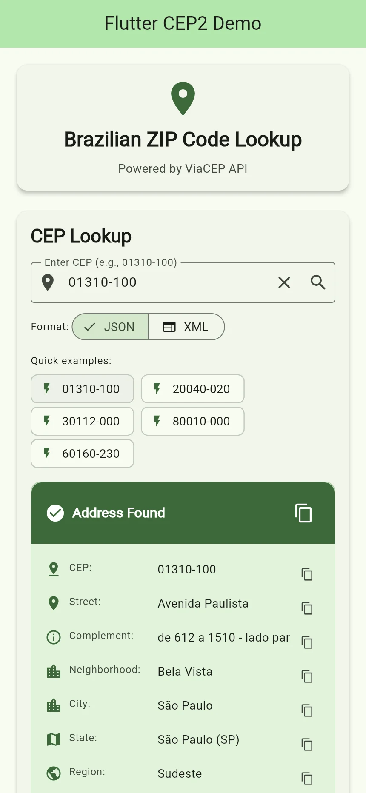

<p align="center">
  
</p>

<p align="center">
  <a href="https://pub.dev/packages/flutter_cep2"></a>
  <a href="https://pub.dev/packages/flutter_cep2/score"></a>
  <a href="https://pub.dev/packages/flutter_cep2/score"></a>
  <a href="https://pub.dev/packages/flutter_cep2/score"></a>
  <br>
  <a href="https://github.com/vitoramaral10/flutter_cep2/actions/workflows/test.yml"></a>
  <a href="https://codecov.io/gh/vitoramaral10/flutter_cep2"></a>
  <a href="LICENSE"></a>
  
</p>

<p align="center">
  <b>Look up any Brazilian CEP, or find the CEPs of a street, with one call.</b><br>
  Provider fallback, built-in cache, coordinates and offline helpers, on every platform. Powered by <a href="https://viacep.com.br/">ViaCEP</a>, <a href="https://brasilapi.com.br/">BrasilAPI</a> and <a href="https://opencep.com/">OpenCEP</a>.
</p>

<p align="center">
  🇧🇷 <i>Busca de CEP e de endereço para Dart e Flutter, com ViaCEP, BrasilAPI e OpenCEP, fallback automático, cache, latitude/longitude e validação de CEP offline.</i>
</p>

<p align="center">
  <a href="#-quick-start">Quick start</a> •
  <a href="#-usage">Usage</a> •
  <a href="#-error-handling">Errors</a> •
  <a href="#-api-reference">API</a> •
  <a href="#-example-app">Example</a> •
  <a href="#-faq">FAQ</a> •
  <a href="#-contributing">Contributing</a>
</p>

---

## ✨ Features

|     | Feature | Details |
|-----|---------|---------|
| 🔎 | **CEP lookup** | `01310-100`, `01310100` and `01.310-100` all work |
| 🗺️ | **Search by address** | State + city + street returns every matching CEP |
| 🧱 | **Typed model** | An immutable `Cep` with value equality and `fromJson`/`toJson` |
| 🚦 | **Clear errors** | One `CepException` with a `CepErrorType` for every failure |
| 🛟 | **Provider fallback** | ViaCEP down or missing the CEP? BrasilAPI and OpenCEP step in |
| ⚡ | **Built-in cache** | Repeated lookups come from memory, not the network |
| 📍 | **Coordinates** | Latitude and longitude from BrasilAPI |
| 📴 | **Offline helpers** | Validate, format and find the state of a CEP with no request |
| ⏱️ | **Timeouts that cancel** | A slow request is aborted, not just abandoned |
| 🔤 | **JSON or XML** | Pick the ViaCEP format; you get the same `Cep` back |
| 🧪 | **Testable** | Inject any `http.Client`; 100% line coverage in the package itself |
| 🌍 | **Pure Dart** | Android, iOS, web, Windows, macOS, Linux and server-side Dart |

## 🚀 Quick start

```bash
dart pub add flutter_cep2      # or: flutter pub add flutter_cep2
```

```dart
import 'package:flutter_cep2/flutter_cep2.dart';

Future<void> main() async {
  final cep = FlutterCep2();
  try {
    final address = await cep.search('01310-100');
    print('${address.logradouro}, ${address.bairro} - ${address.localidade}/${address.uf}');
    // Avenida Paulista, Bela Vista - São Paulo/SP
  } on CepException catch (e) {
    print('Lookup failed: ${e.message}');
  } finally {
    cep.dispose();
  }
}
```

> Requires Dart 3.0+ (Flutter 3.10+).

## 📖 Usage

### Look up a CEP

```dart
final address = await cep.search('01310100');
print(address.estado); // São Paulo
print(address.ddd);    // 11
```

Keep one `FlutterCep2` for as long as you need it and call `dispose()` at the
end: every lookup reuses the same HTTP connection.

### Search by address

Don't know the CEP? Give the state, city and street:

```dart
final matches = await cep.searchAddress('RS', 'Porto Alegre', 'Domingos Jose');
for (final m in matches) {
  print('${m.cep}  ${m.logradouro}, ${m.bairro}');
}
// 91790-072  Rua Domingos José Poli, Restinga
// 90420-200  Rua Domingos José de Almeida, Rio Branco
```

`uf` is the two-letter state code; `city` and `street` need at least 3
characters. ViaCEP returns up to 50 matches, and no match is an empty list, not
an error.

### XML instead of JSON

```dart
await cep.search('01310-100', output: CepOutputFormat.xml);
```

The result is the same `Cep`; only the wire format changes.

### Fallback to other providers

ViaCEP is the default and the only provider asked unless you list more. With
several, `search` asks them in order and returns the first answer:

```dart
final cep = FlutterCep2(
  providers: [CepProvider.viaCep, CepProvider.brasilApi, CepProvider.openCep],
);
```

The next provider is tried when one fails (offline, timeout, HTTP error, bad
body) **or** does not know the CEP, since their databases differ. If all of them
fail, you get `notFound` when any of them said the CEP does not exist, and the
last error otherwise.

| Provider                   | Fields filled                                             |
|----------------------------|-----------------------------------------------------------|
| `CepProvider.viaCep`       | All, plus XML output and `searchAddress`                  |
| `CepProvider.openCep`      | All except `ddd`, `gia` and `siaf`                        |
| `CepProvider.brasilApi`    | `cep`, `logradouro`, `bairro`, `localidade`, `uf`, `ibge`, `latitude`, `longitude` |

`searchAddress` always uses ViaCEP, the only one with address search.

Every `Cep` says who answered in `provider`, so you can weigh the answer by its
source (for example, ask the user to confirm one that did not come from
ViaCEP):

```dart
final address = await cep.search('01310-100');
print(address.provider); // CepProvider.viaCep
```

The providers are not fully independent: BrasilAPI itself asks Correios, ViaCEP
and others, OpenCEP among them, so two providers can agree because they read
the same record.

### Whole-city CEPs

Towns with a single CEP, and some districts, have no street: `logradouro` is
empty in every provider. `isCityWide` tells you so, and a form should then ask
the user for the street:

```dart
final address = await cep.search('86990-000'); // Marialva/PR
if (address.isCityWide) askForStreet();
```

### Cache

```dart
final cep = FlutterCep2(cacheDuration: const Duration(hours: 1));
```

Successful answers of `search` and `searchAddress` are kept in memory for that
long, so a repeated lookup skips the network (and ViaCEP's rate limit). Errors
are never cached, and the cache holds at most `cacheMaxEntries` answers (1000
by default), dropping the oldest.
It is off by default.

### Coordinates

BrasilAPI also returns where the CEP is. Put it first when you need the map
point:

```dart
final cep = FlutterCep2(providers: [CepProvider.brasilApi, CepProvider.viaCep]);
final address = await cep.search('01310-100');
print('${address.latitude}, ${address.longitude}'); // -23.5617698, -46.6553299
```

`latitude` and `longitude` are null when the answer came from another provider
or BrasilAPI does not know the point.

### Offline helpers

No request, no `FlutterCep2` needed:

```dart
isValidCep('01310-100');  // true: 8 digits in a state range (says nothing about existing)
isValidCep('00000-000');  // false: no state uses this number
formatCep('01310100');    // '01310-100'; null when invalid
cepState('01310-100');    // (uf: 'SP', estado: 'São Paulo', regiao: 'Sudeste')
```

`cepState` uses the Correios number ranges: handy to pre-fill the state in a
form or route a request. A few special CEPs break the ranges, so look the CEP
up when the answer must be exact.

### Timeout and custom HTTP client

```dart
final cep = FlutterCep2(
  timeout: const Duration(seconds: 5), // default: 10 seconds
  client: myHttpClient,                // optional; you keep ownership
);
```

When the timeout runs out the request is aborted and `search` throws a
`CepException` of type `timeout`. A client you pass in stays open after
`dispose()`; closing it is up to you.

## 🚨 Error handling

Every failure is a `CepException`. Branch on `type`; `message` is for logs.

```dart
try {
  await cep.search(input);
} on CepException catch (e) {
  switch (e.type) {
    case CepErrorType.invalidFormat:
    case CepErrorType.notFound:
      showFieldError('Check the CEP');
    default:
      showRetry();
  }
}
```

| `type`            | When                                                   |
|-------------------|--------------------------------------------------------|
| `invalidFormat`   | The CEP doesn't have 8 digits or is outside every state range, or the address is too short. Nothing is sent |
| `notFound`        | ViaCEP has no address for the CEP                      |
| `http`            | ViaCEP answered with a status other than 200           |
| `timeout`         | No answer within `timeout`                             |
| `network`         | The request could not be sent (offline, DNS, TLS...)   |
| `invalidResponse` | The body could not be read as a ViaCEP answer          |

With more than one provider, `providerErrors` says what each of them answered
when all of them failed:

```dart
on CepException catch (e) {
  for (final MapEntry(:key, :value) in e.providerErrors.entries) {
    log('$key: ${value.type}'); // CepProvider.viaCep: CepErrorType.timeout ...
  }
}
```

## 🧪 Testing your code

Pass a fake client, for example `MockClient` from `package:http/testing.dart`:

```dart
import 'package:http/http.dart' as http;
import 'package:http/testing.dart';

final client = MockClient((request) async => http.Response(
      '{"cep": "01310-100", "logradouro": "Avenida Paulista", "bairro": "Bela Vista", '
      '"localidade": "São Paulo", "uf": "SP", "ibge": "3550308"}',
      200,
      headers: {'content-type': 'application/json; charset=utf-8'},
    ));
final cep = FlutterCep2(client: client);
```

## 📚 API reference

| Member | Description |
|--------|-------------|
| `FlutterCep2({http.Client? client, Duration timeout, List<CepProvider> providers, Duration? cacheDuration, int cacheMaxEntries})` | Creates the service. `timeout` defaults to 10 seconds, `providers` to ViaCEP only, and the cache is off (1000 answers when on) |
| `Future<Cep> search(String cep, {CepOutputFormat output})` | Looks up one CEP, falling back through `providers` |
| `Future<List<Cep>> searchAddress(String uf, String city, String street, {CepOutputFormat output})` | Lists the CEPs of a street |
| `void dispose()` | Closes the HTTP client the service created |
| `bool isValidCep(String cep)` | Whether the CEP has 8 digits inside a state range, offline |
| `String? formatCep(String cep)` | `XXXXX-XXX`, or null when invalid |
| `cepState(String cep)` | `(uf, estado, regiao)` from the CEP ranges, or null |

Full docs on [pub.dev](https://pub.dev/documentation/flutter_cep2/latest/).

<details>
<summary><b>Fields of <code>Cep</code></b></summary>

| Property      | Type      | Description                            |
|---------------|-----------|----------------------------------------|
| `cep`         | `String`  | Postal code in `XXXXX-XXX` format      |
| `logradouro`  | `String`  | Street name                            |
| `complemento` | `String?` | Extra address info                     |
| `bairro`      | `String`  | Neighborhood                           |
| `localidade`  | `String`  | City                                   |
| `uf`          | `String`  | State abbreviation (SP, RJ, ...)       |
| `estado`      | `String?` | State name (São Paulo, ...)            |
| `regiao`      | `String?` | Region (Sudeste, ...)                  |
| `unidade`     | `String?` | Postal unit                            |
| `ibge`        | `String`  | IBGE municipality code                 |
| `gia`         | `String?` | GIA code (São Paulo only)              |
| `ddd`         | `String?` | Area code                              |
| `siaf`        | `String?` | SIAFI code (`siafi` in the API)        |
| `latitude`    | `double?` | Latitude (BrasilAPI only)              |
| `longitude`   | `double?` | Longitude (BrasilAPI only)             |
| `provider`    | `CepProvider?` | Who answered; null when built by hand |
| `isCityWide`  | `bool`    | No street: the CEP covers a whole city |

`Cep` is immutable, compares by value and converts with `Cep.fromJson` and
`toJson()`.

</details>

## 📱 Example app



The [`example/`](example) folder has a Flutter app that looks up CEPs in JSON or
XML, shows every field of the address and copies any of them with one tap.

```bash
cd example
flutter run
```

<br clear="right">

## ❓ FAQ

<details>
<summary><b>Two providers agree on a CEP ViaCEP does not know. Who is right?</b></summary>

Often ViaCEP. BrasilAPI may be answering with OpenCEP's record (its answer has
`"service": "open-cep"`), so the agreement is one source counted twice. CEP
99999-999, for instance, is in OpenCEP and BrasilAPI as "Avenida das Torres,
Sarandi/PR", while the real CEPs of that street start with 87112 and 87118. Use
`Cep.provider` to treat answers from fallback providers with more care.
</details>

<details>
<summary><b>Is ViaCEP free? Are there limits?</b></summary>

ViaCEP is a free public service, not run by this package. It asks clients not
to send bulk lookups, and heavy use may get your IP blocked. Turn on the
[cache](#cache) and list a [fallback provider](#fallback-to-other-providers) so
a block does not stop your app.
</details>

<details>
<summary><b>Does it work on Flutter web?</b></summary>

Yes. ViaCEP, BrasilAPI and OpenCEP allow cross-origin requests, so the same
code runs in the browser. The example app above is the web build.
</details>

<details>
<summary><b>Can I use it without Flutter?</b></summary>

Yes. The package is pure Dart and only depends on `http`, `xml` and `meta`, so
it also works in CLIs and on the server.
</details>

<details>
<summary><b>Why are the field names in Portuguese?</b></summary>

They mirror the ViaCEP API (`logradouro`, `bairro`, `localidade`...), so
anything you read in the ViaCEP docs maps one to one.
</details>

## 🤝 Contributing

Bug reports, ideas and pull requests are welcome. Read
[CONTRIBUTING.md](CONTRIBUTING.md) to set up the project and see what CI
checks, and follow the [Code of Conduct](CODE_OF_CONDUCT.md). Found a security
issue? Use [SECURITY.md](SECURITY.md), not a public issue.

If this package saves you time, ⭐ the
[repository](https://github.com/vitoramaral10/flutter_cep2) and 👍 it on
[pub.dev](https://pub.dev/packages/flutter_cep2): it helps other people find it.

## 📄 License

[GNU Lesser General Public License v2.1](LICENSE).
