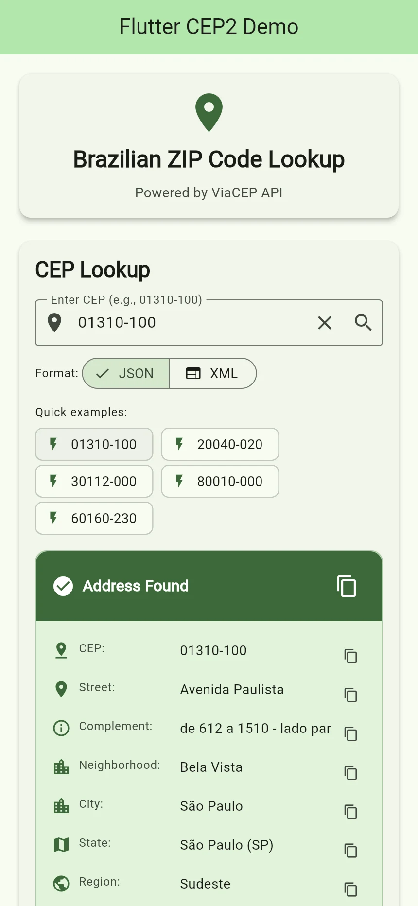

# flutter_cep2 examples

Copy-paste recipes for looking up Brazilian CEPs (ZIP codes) in Dart and
Flutter. Every snippet needs only:

```dart
import 'package:flutter_cep2/flutter_cep2.dart';
```

## Look up a CEP

```dart
final cep = FlutterCep2();
try {
  final address = await cep.search('01310-100');
  print('${address.logradouro}, ${address.bairro} - ${address.localidade}/${address.uf}');
  // Avenida Paulista, Bela Vista - São Paulo/SP
} on CepException catch (e) {
  print('Lookup failed (${e.type}): ${e.message}');
} finally {
  cep.dispose();
}
```

## Never fail because ViaCEP is down

Fall back to BrasilAPI and OpenCEP, and cache answers for an hour:

```dart
final cep = FlutterCep2(
  providers: [CepProvider.viaCep, CepProvider.brasilApi, CepProvider.openCep],
  cacheDuration: const Duration(hours: 1),
);
final address = await cep.search('01310100');
```

## Find the CEPs of a street

```dart
final matches = await FlutterCep2().searchAddress('SP', 'São Paulo', 'Paulista');
for (final m in matches) {
  print('${m.cep}  ${m.logradouro}, ${m.bairro}');
}
```

## Get latitude and longitude

```dart
final address = await FlutterCep2(providers: [CepProvider.brasilApi])
    .search('01310-100');
print('${address.latitude}, ${address.longitude}'); // -23.5617698, -46.6553299
```

## Validate and format offline

```dart
isValidCep('01310-100'); // true
formatCep('01310100');   // '01310-100'
cepState('01310-100');   // (uf: 'SP', estado: 'São Paulo', regiao: 'Sudeste')
```

## Show the right message in a form

```dart
try {
  await cep.search(input);
} on CepException catch (e) {
  final message = switch (e.type) {
    CepErrorType.invalidFormat => 'Type the 8 digits of the CEP',
    CepErrorType.notFound => 'CEP not found',
    _ => 'Could not reach the CEP service, try again',
  };
  showError(message);
}
```

## Flutter app



This folder is also a Flutter app: type a CEP or tap one of the samples, pick
JSON or XML, and see every field of the address with a copy button.

```bash
cd example
flutter pub get
flutter run
```

The code is in [`lib/main.dart`](lib/main.dart). The part that uses the package
is `_CepLookupWidgetState`: one `FlutterCep2` created with the state, `search`
in `_searchCep`, `CepException` shown to the user, and `dispose()` with the
widget. Run its tests with `flutter test`.
